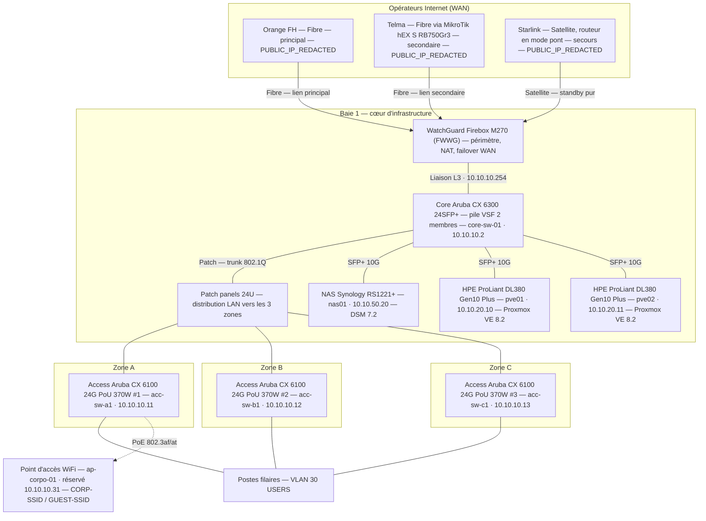
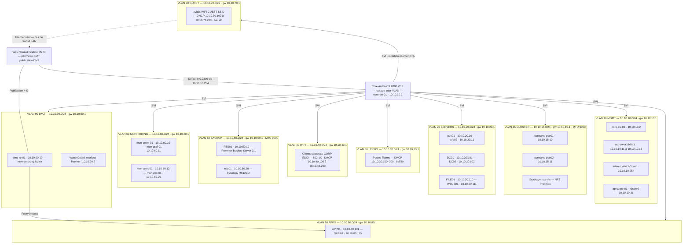
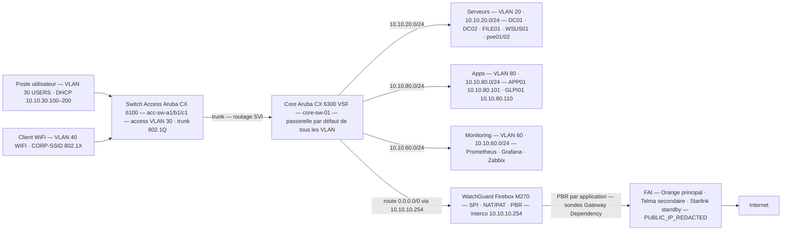
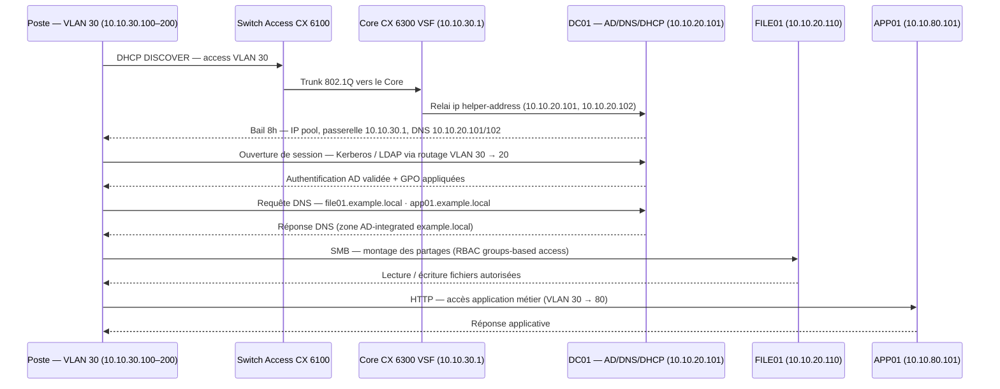
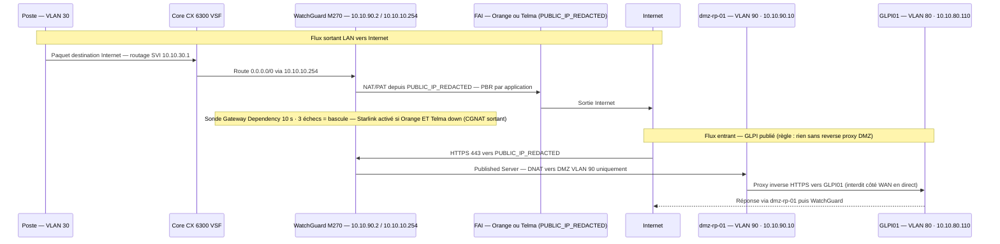
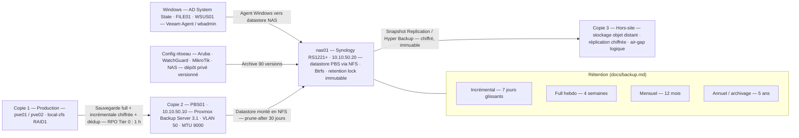
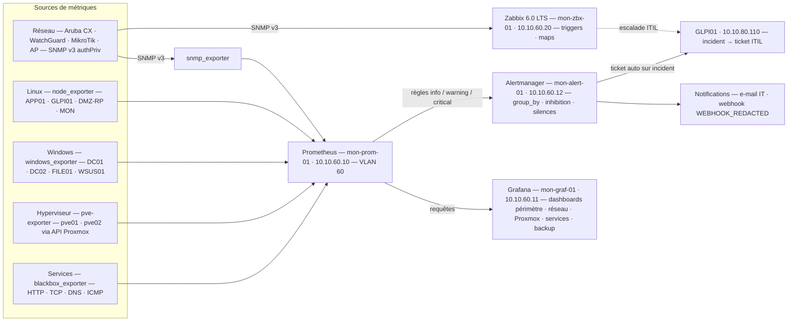

# Diagrammes — refonte réseau & systèmes

> Source de vérité : [`docs/00-architecture-reference.md`](../docs/00-architecture-reference.md).
> Données anonymisées : adresses publiques `PUBLIC_IP_REDACTED`, domaine `example.local`.
> Chaque diagramme existe en fichier `.mmd` (Mermaid v10) et est rendu ci-dessous.
> Les versions **animées** (SVG + CSS + JS autonomes) sont dans [`animated/`](animated/README.md).

## Index

| Diagramme | Fichier | But |
|-----------|---------|-----|
| Topologie Physique | [`topologie-physique.mmd`](./topologie-physique.mmd) | Topologie physique : patch panels, Core Aruba VSF, 3 switches d'accès, WatchGuard, 3 FAI, NAS et les 2 serveurs HPE ProLiant. |
| Topologie Logique | [`topologie-logique.mmd`](./topologie-logique.mmd) | Segmentation VLAN 10 à 90 avec sous-réseaux, passerelles SVI et placement des hôtes/VM dans chaque VLAN. |
| Architecture Proxmox | [`architecture-proxmox.mmd`](./architecture-proxmox.mmd) | Cluster Proxmox VE 8.2 pve01/pve02 : bridges vmbr0/vmbr1, stockage local-zfs + nas-nfs + datastore PBS, affectation des VMID 101 à 501. |
| Flux Lan Wan | [`flux-lan-wan.mmd`](./flux-lan-wan.mmd) | Flux LAN→WAN : poste → accès → core puis serveurs/apps/GLPI, et core → WatchGuard → FAI → Internet. |
| Flux Utilisateur | [`flux-utilisateur.mmd`](./flux-utilisateur.mmd) | Séquence utilisateur : DHCP/ouverture de session, authentification AD, DNS, SMB vers FILE01, HTTP vers l'app métier. |
| Flux Internet | [`flux-internet.mmd`](./flux-internet.mmd) | Séquence Internet : sortants NAT/PAT + failover 3 FAI, entrants GLPI publié via reverse proxy DMZ. |
| Backup | [`backup.mmd`](./backup.mmd) | Chaîne de sauvegarde 3-2-1 : VM prod → PBS01 → NAS Synology → réplication chiffrée hors-site, avec rétention GFS. |
| Monitoring | [`monitoring.mmd`](./monitoring.mmd) | Pile de supervision : exporters → Prometheus → Grafana/Alertmanager → notifications, Zabbix et SNMP v3 vers les équipements réseau. |

---

## topologie-physique.mmd

Topologie physique : patch panels, Core Aruba VSF, 3 switches d'accès, WatchGuard, 3 FAI, NAS et les 2 serveurs HPE ProLiant.

## topologie-logique.mmd

Segmentation VLAN 10 à 90 avec sous-réseaux, passerelles SVI et placement des hôtes/VM dans chaque VLAN.

## architecture-proxmox.mmd

Cluster Proxmox VE 8.2 pve01/pve02 : bridges vmbr0/vmbr1, stockage local-zfs + nas-nfs + datastore PBS, affectation des VMID 101 à 501.

```mermaid
%% Architecture Proxmox VE 8.2 — cluster pve01/pve02 — source de vérité : docs/00-architecture-reference.md
flowchart TD
    subgraph CLU["Cluster Proxmox VE 8.2 — corosync sur VLAN 15 CLUSTER · MTU 9000"]
        direction TB
        subgraph H1["pve01.example.local — 10.10.20.10 · corosync 10.10.15.10"]
            direction TB
            BR0A["vmbr0 — LAN VM · VLAN étiquetés"]
            BR1A["vmbr1 — cluster + stockage · VLAN 15"]
            V101["101 · DC01 · 10.10.20.101 · VLAN 20"]
            V110["110 · FILE01 · 10.10.20.110 · VLAN 20"]
            V111["111 · WSUS01 · 10.10.20.111 · VLAN 20"]
            V301["301 · PBS01 · 10.10.50.10 · VLAN 50"]
            V410["410 · MON-ZBX · 10.10.60.20 · VLAN 60"]
            ZFS1["local-zfs pve01 — RAID1 local HPE"]
        end
        subgraph H2["pve02.example.local — 10.10.20.11 · corosync 10.10.15.11"]
            direction TB
            BR0B["vmbr0 — LAN VM · VLAN étiquetés"]
            BR1B["vmbr1 — cluster + stockage · VLAN 15"]
            V102["102 · DC02 · 10.10.20.102 · VLAN 20"]
            V201["201 · APP01 · 10.10.80.101 · VLAN 80"]
            V210["210 · GLPI01 · 10.10.80.110 · VLAN 80"]
            V401["401 · MON-PROM · 10.10.60.10 · VLAN 60"]
            V402["402 · MON-GRAF · 10.10.60.11 · VLAN 60"]
            V403["403 · MON-ALERT · 10.10.60.12 · VLAN 60"]
            V501["501 · DMZ-RP · 10.10.90.10 · VLAN 90"]
            ZFS2["local-zfs pve02 — RAID1 local HPE"]
        end
    end

    NFS["nas-nfs — datastore NFS via VLAN 15 · MTU 9000"]
    NAS["nas01 — Synology RS1221+ · 10.10.50.20 · DSM 7.2"]
    PBD["PBS 3.1 — datastore de sauvegarde sur NAS · prune-after 30 j"]

    V101 -->|" VLAN 20 "| BR0A
    V110 -->|" VLAN 20 "| BR0A
    V111 -->|" VLAN 20 "| BR0A
    V301 -->|" VLAN 50 "| BR0A
    V410 -->|" VLAN 60 "| BR0A
    V102 -->|" VLAN 20 "| BR0B
    V201 -->|" VLAN 80 "| BR0B
    V210 -->|" VLAN 80 "| BR0B
    V401 -->|" VLAN 60 "| BR0B
    V402 -->|" VLAN 60 "| BR0B
    V403 -->|" VLAN 60 "| BR0B
    V501 -->|" VLAN 90 "| BR0B

    BR1A ---|"corosync + stockage"| BR1B
    BR1A --- NFS
    BR1B --- NFS
    NFS --- NAS
    BR0A -.-> ZFS1
    BR0B -.-> ZFS2
    V301 -->|"sauvegardes incrémentales chiffrées"| PBD
    PBD -->|"montage NFS"| NAS
```

## flux-lan-wan.mmd

Flux LAN→WAN : poste → accès → core puis serveurs/apps/GLPI, et core → WatchGuard → FAI → Internet.

## flux-utilisateur.mmd

Séquence utilisateur : DHCP/ouverture de session, authentification AD, DNS, SMB vers FILE01, HTTP vers l'app métier.

## flux-internet.mmd

Séquence Internet : sortants NAT/PAT + failover 3 FAI, entrants GLPI publié via reverse proxy DMZ.

## backup.mmd

Chaîne de sauvegarde 3-2-1 : VM prod → PBS01 → NAS Synology → réplication chiffrée hors-site, avec rétention GFS.

## monitoring.mmd

Pile de supervision : exporters → Prometheus → Grafana/Alertmanager → notifications, Zabbix et SNMP v3 vers les équipements réseau.

